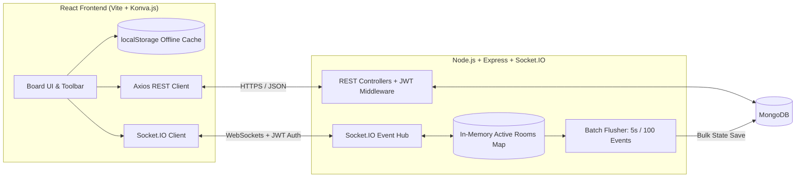

# BoardCollab — Real-Time Collaborative Whiteboard

BoardCollab is a full-stack MERN real-time collaborative whiteboard application inspired by tools like Figma and Miro. Multiple users can authenticate, create or join public/private rooms, sketch freehand strokes, add shapes and text, track live cursors, perform isolated per-user undo/redo actions, and export canvases as PNGs with automatic batched persistence to MongoDB.

---

## Tech Stack

- **Frontend:** React (Vite), Konva.js (`react-konva`), Redux Toolkit, React Router, Tailwind CSS, Remix Icons, Sileo Toasts, Axios, Socket.IO Client
- **Backend:** Node.js, Express.js, Socket.IO, JSON Web Tokens (`jsonwebtoken`), `bcryptjs`, Mongoose
- **Database:** MongoDB (Mongoose ODM)

---

## Project Structure

```text
boardCollab/
├── client/
│   ├── public/
│   └── src/
│       ├── assets/
│       ├── components/        # Reusable UI components (e.g., Logout)
│       ├── store/             # Redux Toolkit store configuration
│       ├── utils/
│       │   ├── api.js         # Axios instance with JWT interceptor
│       │   └── socket.js      # Socket.IO client connection manager
│       ├── views/
│       │   ├── Home.jsx
│       │   ├── Register.jsx   # Account registration & login modal
│       │   ├── Rooms.jsx      # Active rooms list, private room modal & creation
│       │   └── whiteBoard/
│       │       └── Board.jsx  # Konva.js collaborative canvas & toolbar
│       ├── App.jsx
│       └── main.jsx
├── server/
│   ├── config/
│   │   └── connectDB.js       # MongoDB connection handler
│   ├── controllers/
│   │   ├── auth.js            # Register & Login controllers
│   │   ├── health.js          # Server & DB health check
│   │   └── roomController.js  # Create, list, join & owner-only delete rooms
│   ├── middlewares/
│   │   └── auth.middleware.js # JWT verification middleware
│   ├── models/
│   │   ├── User.js            # User schema (name, email, hashed password)
│   │   └── Room.js            # Room/Session schema (roomId, owner, elements, users)
│   ├── sockets/
│   │   └── socketsHandler.js  # Real-time WebSocket hub & 5s batched DB persistence
│   ├── utils/
│   │   └── responder.js       # Standardized API JSON response wrapper
│   └── index.js               # Express app, direct controller routes & Socket.IO server
└── README.md
```

---

## System Architecture



---

## Key Features & Engineering Highlights

1. **JWT Authentication & Room Access Control**
   - Stateless JWT authentication protects all REST endpoints and validates WebSocket handshakes (`socket.handshake.auth.token`).
   - Supports both **public** and **password-protected private rooms**, plus **owner-only room deletion**.
2. **Real-Time Canvas Synchronization (<100ms Latency)**
   - Built with `react-konva` supporting **Select/Move/Resize** (via Konva `Transformer`), **Pen**, **Rectangle**, **Circle**, **Text**, and **Eraser** tools.
   - Throttled live cursor broadcasting (`50ms`) displays teammates' names and pointer positions in real time.
3. **Batched MongoDB Persistence (Write Contention Mitigation)**
   - Active rooms are cached in an in-memory `Map` on the server to prevent database write thrashing during high-frequency drawing events.
   - Dirty room states are flushed to MongoDB automatically every **5 seconds** or whenever **100 pending events** accumulate, as well as immediately when the last user disconnects.
4. **Per-User Undo / Redo & Offline Resilience**
   - Each participant maintains an isolated local history/redo stack so undoing removes only their own elements across all connected clients without disrupting teammates.
   - Canvas elements are mirrored to `localStorage` (`board_cache_<roomId>`) for instant recovery on page reload or temporary network drops, alongside a **30-second WebSocket heartbeat**.
5. **Horizontal Scaling & Sharding Strategy (Production Notes)**
   - For multi-instance deployments, attach `@socket.io/redis-adapter` to distribute WebSocket room broadcasts across Node workers and shard the MongoDB `rooms` collection on `{ roomId: "hashed" }` (supporting up to 10,000 elements per session).

---

## Getting Started

### Prerequisites
- **Node.js** v18+
- **MongoDB** (Local instance or MongoDB Atlas URI)

### 1. Clone the Repository
```bash
git clone https://github.com/sarrthak008/BoardCollab_Sarthak/
cd boardCollab
```

### 2. Configure & Start the Backend (`server/`)
```bash
cd server
npm install
```

Create a `.env` file inside `server/`:
```env
PORT=5000
MONGO_URI=mongodb://127.0.0.1:27017/boardcollab
JWT_SECRET=your_super_secret_jwt_key
CLIENT_URL=http://localhost:5173
```

Start the backend server:
```bash
npm run dev
```

### 3. Configure & Start the Frontend (`client/`)
Open a new terminal:
```bash
cd client
npm install
```

Create a `.env` file inside `client/`:
```env
VITE_API_URL=http://localhost:5000
```

Start the Vite development server:
```bash
npm run dev
```

Open `http://localhost:5173` in two browser windows to test multi-user real-time collaboration.

---

## API & WebSocket Reference

### REST Endpoints
| Method | Endpoint | Auth | Description |
| :--- | :--- | :--- | :--- |
| `GET` | `/health` | Public | Returns Express server and MongoDB connection status |
| `POST` | `/api/auth/register` | Public | Register a new user and return a JWT |
| `POST` | `/api/auth/login` | Public | Authenticate user and return a JWT |
| `GET` | `/api/rooms` | Bearer JWT | List all active rooms with online user counts |
| `POST` | `/api/rooms` | Bearer JWT | Create a new public or password-protected room |
| `GET` | `/api/rooms/:id` | Bearer JWT | Fetch room metadata & saved canvas elements |
| `DELETE` | `/api/rooms/:id` | Bearer JWT | Delete a room (restricted to the room `owner`) |

### Socket.IO Events
| Event | Direction | Payload | Description |
| :--- | :--- | :--- | :--- |
| `join-room` | Client → Server | `{ roomId }` | Joins room, emits `canvas-state` & updates `room-users` |
| `draw-stroke` | Client ↔ Server | `{ roomId, element }` | Broadcasts new stroke, shape, or text element to peers |
| `update-element` | Client ↔ Server | `{ roomId, element }` | Syncs dragged, resized, or recolored elements |
| `undo` / `redo` | Client ↔ Server | `{ roomId, elementId / element }` | Syncs isolated per-user undo/redo actions |
| `clear-canvas` | Client ↔ Server | `{ roomId }` | Clears all elements in the room and flushes to DB |
| `cursor-move` | Client ↔ Server | `{ roomId, x, y }` | Broadcasts live user pointer coordinates |
| `heartbeat` | Client ↔ Server | — | 30-second keep-alive ping/pong check |
